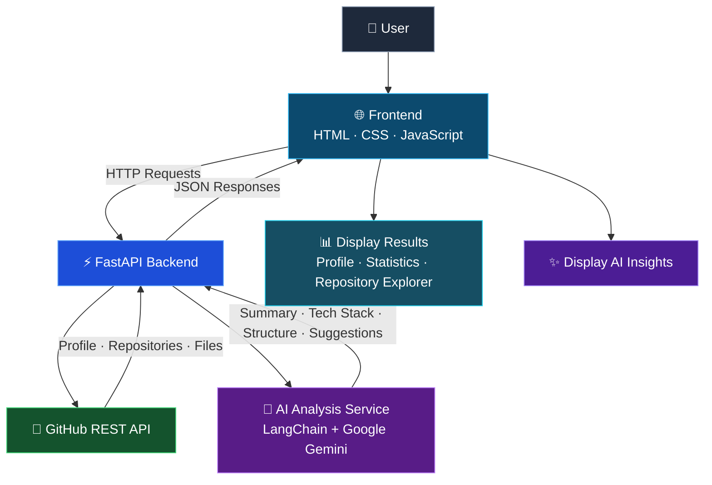

# 🚀 GitHub Repository Analyzer AI

**Explore. Analyze. Improve.**

GitHub Repository Analyzer AI is an AI-powered web application that helps developers understand GitHub profiles and repositories. It retrieves public GitHub data, explores repository files and folders, and uses a Large Language Model (LLM) to generate project insights and improvement suggestions.

## ✨ Features

### 1. 👤 GitHub Profile Extractor
Retrieve and display public GitHub profile information, including username, profile details, followers, following, and public repository count.

### 2. 📊 Repository Statistics
Analyze a GitHub user's repositories and display:
- Total number of public repositories
- Total stars across repositories
- Most-used programming language
- Repository with the highest star count

### 3. 📚 Repository Explorer
Fetch and display a user's public repositories, making it easier to browse projects and select a repository for further analysis.

### 4. 📁 Repository File Extractor
Explore a selected repository's files, folders, and directory structure to understand how the project is organized.

### 5. 🤖 AI-Powered Repository Analysis
Use AI to analyze a selected repository and generate:
- **Project Summary:** Understand the project's purpose and functionality.
- **Technology Stack:** Identify the technologies and tools used.
- **Project Structure:** Explain the organization of files and folders.
- **Improvement Suggestions:** Discover potential enhancements and recommended next steps.
- **README Validation:** Identify when a README is empty or contains only a title, warning that the analysis may be incomplete.

## 🛠️ Technology Stack

| Technology | Purpose |
|---|---|
| Python | Backend programming |
| FastAPI | REST API and backend development |
| JavaScript | Frontend interaction and API integration |
| HTML5 | Web page structure |
| CSS3 | Styling and responsive layout |
| GitHub REST API | Retrieve public GitHub profile and repository data |
| LangChain | Integrate the language model into the application |
| Google Gemini | AI-powered repository analysis |

## 🔄 How It Works

1. Enter a GitHub username.
2. Retrieve and review profile details and repository statistics.
3. Browse the user's public repositories.
4. Select a repository and explore its files and folders.
5. Run AI analysis to generate a project summary, identify technologies, explain the structure, and receive improvement suggestions.

## 🏗️ Project Architecture

The application uses a frontend-backend architecture that integrates GitHub's REST API with an AI-powered repository analysis workflow.



### Architecture Components

- **Frontend:** Collects the GitHub username, displays profile and repository information, and presents AI-generated results.
- **FastAPI Backend:** Handles frontend requests, retrieves GitHub data, and coordinates AI analysis.
- **GitHub REST API:** Provides public profile, repository, and file information.
- **AI Analysis Service:** Uses LangChain and Google Gemini to generate repository summaries, identify technologies, explain project structure, and suggest improvements.
- **Results Display:** Presents repository information and AI insights through the web interface.


## 📂 Project Structure

The project is organized around a frontend and a FastAPI backend. A representative structure is shown below; adjust the filenames to match your actual repository.

```text
github-repository-analyzer-ai/
│
├── frontend/
│   ├── index.html
│   ├── style.css
│   ├── script.js
│   ├── files.html
│   └── files.js
|   └── files.css
│
├── backend/
│   ├── main.py
│   ├── requirements.txt
│   └── test.py
│
├── .gitignore
└── README.md
```

## ⚙️ Getting Started

### Prerequisites

Make sure you have installed:

- Python 3.10 or a compatible version for your dependencies
- A modern web browser
- A Google Gemini API key for AI analysis

### 1. Clone the Repository

```bash
git clone https://github.com/Santhosh2006kumar/GitHub-Repository-Analyzer-AI.git
cd GitHub-Repository-Analyzer-AI
```


### 2. Set Up the Backend

Navigate to the backend directory:

```bash
cd backend
```


Install the project dependencies:

```bash
pip install -r requirements.txt
```

### 3. Configure Environment Variables

Create a `.env` file inside the backend directory and add your Gemini API key:

```env
GOOGLE_API_KEY=your_gemini_api_key
```

Use the environment variable name expected by your code. Never commit API keys or other secrets to GitHub.

### 4. Start the FastAPI Server

From the backend directory, run:

```bash
uvicorn main:app --reload
```
or 

```bash
python -m uvicorn main:app --reload
```

The backend will usually be available at:

```text
http://127.0.0.1:8000
```

Explore the API documentation at:

```text
http://127.0.0.1:8000/docs
```

### 5. Run the Frontend

Open the frontend using a local development server or the setup configured for your project. Ensure the frontend's API base URL points to the running FastAPI server.

## 🔐 Security and Limitations

- The application works with publicly accessible GitHub profile and repository information.
- GitHub API rate limits may affect repeated or large requests.
- AI analysis depends on the availability and configuration of the selected Gemini model.
- Analysis quality depends on the available repository files, README content, and information supplied to the model.
- AI-generated summaries and recommendations should be reviewed before being used in real projects.
- Keep API keys in environment variables and exclude `.env` from version control.

## 🎯 Learning Outcomes

Building this project provides practical experience with:

- Integrating third-party REST APIs
- Developing backend APIs using FastAPI
- Connecting a JavaScript frontend to a Python backend
- Retrieving and presenting structured JSON data
- Exploring GitHub repositories programmatically
- Integrating LLMs using LangChain and Google Gemini
- Designing an AI-assisted developer tool

## 🔮 Future Enhancements

Potential future improvements include:

- Repository comparison and insights
- Deeper code-level analysis
- Downloadable analysis reports
- Support for additional AI models
- More detailed dependency and security insights

## 👨‍💻 Author

**Santhosh Kumar S.**

Final-year B.Tech — Artificial Intelligence and Data Science

---

⭐ If you find this project interesting, consider starring the repository!

**GitHub Repository Analyzer AI — Explore. Analyze. Improve.**
